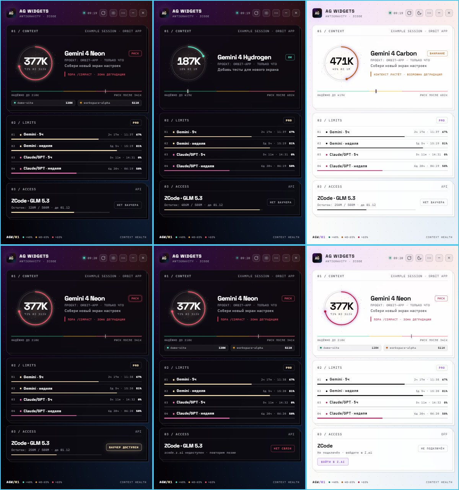

# AG Widgets

**Видеть контекст чата Antigravity, который открыт прямо сейчас, — и не упускать ваучеры ZCode.**



Antigravity показывает лимиты 5ч/неделя в процентах и время до обновления, но не показывает расход контекста конкретного открытого чата — это известная недоработка Google. А ZCode регулярно выдаёт ваучеры на 300–500 млн токенов: если не заходить проверять каждый день, ваучер может истечь незаметно.

AG Widgets сделан ровно для двух задач:

1. **Показать контекст открытого в данный момент чата Antigravity.** Приложение определяет активный чат по annotation-файлам Antigravity и показывает модель, токены/окно, зону здоровья и недавние диалоги именно этого чата — а не последнего, который успел ответить.
2. **Не упустить ваучер ZCode.** Виджет сам опрашивает API ZCode, показывает состояние ваучера и баланс на ПК и передаёт их на телефон даже при выключенном компьютере.

У обоих клиентов один визуальный язык (чёрное стекло, тёплый кремовый акцент, Space Grotesk + моно-лейблы, светлая и тёмная темы):

1. **Десктоп-виджет** — Electron на Windows. Показывает контекст открытого чата, квоты 5ч/неделя, ваучеры и баланс ZCode.
2. **Android-приложение + виджет 4×2** — Kotlin/Jetpack Glance. Работает при выключенном ПК: читает приватный ntfy-канал, сам опрашивает `zcode.z.ai` и ставит локальное напоминание ко времени сброса квоты.

English documentation: [README.md](README.md).

---

## Что показывают карточки

| Карточка | ПК | Android |
|---|---|---|
| **01 · Контекст** | Контекст открытого сейчас чата: модель, токены/окно, зона здоровья, недавние чаты | 4 кольца квот + сводка контекста ПК |
| **02 · Лимиты** | Проценты и время до сброса Antigravity рядом с контекстом | Те же данные в виджете 4×2 |
| **03 · Доступ** | Ваучеры ZCode, баланс, план, вход через OAuth | Прямой опрос ZCode без ПК |

Десктоп-виджет фиксирован 400×640, по умолчанию поверх всех окон и живёт в трее. Android-виджет — изменяемая Glance-поверхность 4×2 со светлой и тёмной темой.

---

## Архитектура

```text
Windows
  Antigravity hook (PostInvocation/Stop)
    └─► %LOCALAPPDATA%\ag-widgets\state\context.json
  Antigravity CLI statusLine
    ├─► agy_status.json              (квоты, plan tier, окно контекста)
    └─► model_windows_learned.json   (реальное окно, которое сообщил CLI)
  Collector sidecar (раз в минуту)
    ├─ agy -p "/usage" --output-format json   → квоты Antigravity
    ├─ zcode.z.ai marketing/touch + billing   → ваучеры и баланс
    └─ POST https://ntfy.sh/<private-topic>   → только числа, без секретов

Android
  WorkManager (каждые 15 минут, best-effort)
    ├─ GET ntfy.sh/<topic>/json?poll=1&since=latest → квоты + контекст ПК
    ├─ GET zcode.z.ai (OAuth-токен)                  → ваучеры и баланс
    └─ локальное напоминание около reset_time
```

### Структура репозитория

```text
agwidgets/            ядро на Python (пути, модель контекста, Antigravity, ZCode, ntfy, статус)
collector/            CLI-точки входа: collector.py, agy_statusline.py, zcode_auth.py
hook/                 точка входа хука Antigravity
desktop/              Electron-приложение
  src/main/           пути, хранилище, окно, трей, IPC, запуск коллектора, OAuth
  src/renderer/       форматирование, контекст, квоты, ZCode, превью, загрузка
android/              Kotlin-приложение, Glance-виджет, WorkManager
tests/                юнит-тесты Python
docs/                 превью и заметки о здоровье контекста
```

Runtime-данные никогда не лежат в репозитории:

```text
%LOCALAPPDATA%\ag-widgets\
  config.json         runtime-конфиг (топик, пороги, оверрайды)
  secrets.json        токен ZCode и device id
  state\              context.json, status.json, agy_status.json, learned windows
```

---

## Требования

- Windows 10/11 (acrylic-блюр — только Windows 11 22H2+)
- Python 3.10+
- Node.js 22.12+ и npm (Electron 45)
- [Google Antigravity](https://antigravity.google) с CLI `agy` в PATH
- Опционально: JDK 17 и Android SDK для Android-приложения

---

## Установка (Windows)

```powershell
git clone https://github.com/DmytroHnylytskyi/ag_widgets.git ag-widgets
cd ag-widgets
powershell -ExecutionPolicy Bypass -File .\install.ps1
```

Установщик:

1. создаёт `%LOCALAPPDATA%\ag-widgets\config.json` из `config.example.json`;
2. регистрирует хук контекста в `~/.gemini/config/hooks.json`;
3. ставит sidecar коллектора (раз в минуту) и включает его в Antigravity;
4. настраивает statusLine Antigravity CLI;
5. устанавливает зависимости Electron;
6. один раз запускает коллектор и создаёт приватный ntfy-топик;
7. создаёт ярлыки **AG Widgets** на рабочем столе и в меню «Пуск».

Полезные флаги:

```powershell
.\install.ps1 -PythonPath "C:\Path\To\python.exe"   # явный интерпретатор
.\install.ps1 -NoShortcut                           # без ярлыков
```

> `ntfy_topic` в `config.json` — секрет. Кто знает топик, тот читает опубликованные числа. Не коммитьте и не передавайте его.

### Запуск

Двойной клик по ярлыку **AG Widgets**, `start-widget.vbs` или:

```powershell
cd desktop
npm start
```

Кнопки в заголовке: **⟳ / F5** — обновить, **☀/☾** — тема, **⋯** — меню, **−** — свернуть в панель задач, **×** — выйти. Правый клик открывает то же меню; перетаскивание — за заголовок.

### Вход в ZCode

Самый простой путь — кнопка **ВОЙТИ В Z.AI** в карточке `03 / ACCESS`: откроется официальная страница Z.ai, токен сохранится локально. То же доступно из CLI:

```powershell
python collector\zcode_auth.py            # вход через браузер
python collector\zcode_auth.py --status   # проверить сохранённый токен
python collector\zcode_auth.py --set-token <jwt>
```

Без токена карточка честно показывает «не подключён». Эвристик по тексту окна больше нет: состояние ваучера приходит только из API ZCode.

### Конфигурация

`%LOCALAPPDATA%\ag-widgets\config.json`:

```json
{
  "model_windows": {},
  "context_thresholds": {
    "yellow_pct": 40,
    "red_pct": 65
  }
}
```

- `model_windows` — ручные оверрайды, например `{ "gemini-4-neon": 524288 }`. Пустой объект означает «взять значение CLI или встроенную таблицу».
- `context_thresholds` — проценты реального окна, где карточка становится жёлтой/красной.

Установщик также пишет сюда `python_path`, чтобы виджет мог запускать обновление.

### Превью дизайна без Electron

Откройте `desktop/index.html` с мок-состоянием:

```text
desktop/index.html?preview=red
desktop/index.html?preview=yellow
desktop/index.html?preview=green
desktop/index.html?preview=empty
desktop/index.html?preview=offline
desktop/index.html?preview=voucher
desktop/index.html?preview=disabled
desktop/index.html?preview=summary
desktop/index.html?preview=red&theme=light
```

---

## Здоровье контекста

Единого «порога галлюцинаций» нет: качество деградирует непрерывно и зависит от задачи, дистракторов и места факта в промпте.

Поэтому AG Widgets считает зоны относительно **реального** окна, которое сообщает Antigravity:

| Зона | Порог | Что значит |
|---|---:|---|
| 🟢 OK | < 40% | рабочая зона |
| 🟡 Внимание | 40–65% | на сложных задачах качество уже падает |
| 🔴 Риск | > 65% | надёжная часть окна закончилась — пора `/compact` |

Абсолютные примеры:

| Модель | 🟡 с | 🔴 после |
|---|---:|---:|
| Gemini 4 Neon (512K) | ~210K | ~341K |
| Модели на 1M (Carbon/Argon/Hydrogen, Claude 5.5) | ~419K | ~682K |
| GPT-OSS 120B (128K) | ~52K | ~85K |

Окна по умолчанию:

| Модель | Окно |
|---|---:|
| Gemini 4 Neon | 512K (1M только в Gemini API) |
| Gemini 4 Carbon / Argon / Hydrogen | 1M |
| Gemini 3.8 Flash | 1M |
| Claude Opus 5.5 / Sonnet 5.5 | 1M |
| GPT-OSS 120B | 128K |

Antigravity CLI отдаёт точное `context_window_size`; statusLine кэширует его для каждой модели, и это значение важнее таблицы. Исследования и источники — в [docs/CONTEXT_HEALTH.md](docs/CONTEXT_HEALTH.md).

---

## Android

### Сборка

Нужны JDK 17 и Android SDK.

```powershell
cd android

# Публичная сборка: без вшитого топика.
.\gradlew.bat assembleDebug -Pcommunity=true

# Личная сборка: берёт agw.topic из local.properties (файл в .gitignore).
.\gradlew.bat assembleDebug
```

APK: `android/app/build/outputs/apk/debug/app-debug.apk`. Для релиза скопируйте community-сборку в `dist/ag-widgets-community.apk` (`dist/` в `.gitignore`).

**Перед публикацией APK** всегда собирайте с `-Pcommunity=true`, чтобы личный ntfy-топик не попал в `BuildConfig`.

### Первый запуск

1. Откройте приложение и разрешите уведомления.
2. Вставьте `ntfy_topic`, который напечатал установщик.
3. Нажмите **Войти в Z.ai** для автономной проверки ваучеров и баланса.
4. Нажмите **Обновить**, затем **Добавить виджет на экран**.

Приложение обновляется каждые 15 минут (минимум WorkManager). Вручную: кнопка в приложении, **⟳** в карточке контекста или тап по виджету. После переключения чата на ПК десктоп публикует новый активный чат сразу; на телефоне нажмите **⟳**, чтобы подхватить его.

> applicationId — `dev.agwidgets`. Если раньше было установлено приватное приложение с другим id, сначала удалите его: Android не переносит настройки между applicationId.

Кнопка **☀/☾** в шапке переключает светлую и тёмную тему; виджет 4×2 следует за приложением. По умолчанию тема системная.

---

## Приватность

- В ntfy уходят числа квот, счётчик токенов, id модели, уровень контекста, UUID диалога, флаг ваучера и короткая подпись ваучера (≤100 символов). Без email, промптов, названий чатов/проектов и токенов.
- `ntfy_topic` — 96 случайных бит, хранится только в `%LOCALAPPDATA%\ag-widgets\config.json`.
- Токен ZCode хранится локально в `secrets.json` (ПК) или приватных SharedPreferences (Android).
- На Android `allowBackup="false"`: prefs не попадают в облачный бэкап.
- Community-APK не содержит ни топика, ни токена. Personal-APK вшивает только топик из `local.properties`.

---

## Проверка

```powershell
# Python: окна моделей, пороги, парсинг ZCode, детект изменений
python -m unittest discover -s tests -p "test_*.py" -v

# Android: парсинг статуса и слияние ПК/телефон
cd android
.\gradlew.bat :app:testDebugUnitTest

# Community-сборка
.\gradlew.bat assembleDebug -Pcommunity=true
```

---

## Ограничения

- **Acrylic** — только Windows 11 22H2+. На Windows 10 останется полупрозрачный фон без системного блюра.
- Android-виджет не может размывать обои системно — используется стеклянная имитация (градиент, обводка, блик).
- **WorkManager** — best-effort: минимум 15 минут, экономия батареи может растянуть интервал. Напоминания о сбросе ставятся локально, но не гарантируются до секунды.
- **ZCode API** — открытый протокол, которым пользуется ZCode; эндпоинты могут меняться. Fallback-скрапинга нет.
- Окна моделей могут обновляться. Значение CLI подхватывается автоматически; встроенная таблица — только запасной вариант.

---

## Лицензия

MIT. См. [LICENSE](LICENSE).
